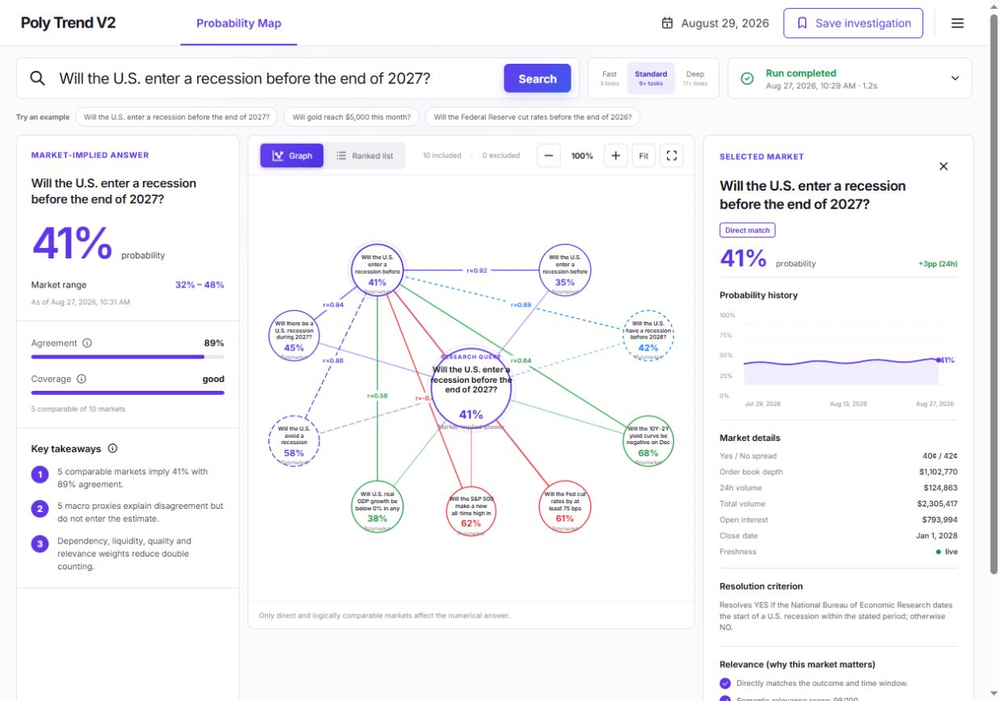

# Poly Trend V2

Poly Trend V2 is an adaptive multi-agent research terminal. It separates direct prediction-market answers from transparent asset-price scenario forecasts:

`question → manager plan → parallel specialists → evidence merge → deterministic analytics → skeptical verification → saved run`

The product is deliberately a single-analyst tool. It does not include trading, portfolios, authentication, or report-style agent demonstrations.



See the [installation and usage guide](docs/USER_GUIDE.md) for setup, provider configuration, and reproducible example questions.

## What is implemented

- Graph-first Probability Map with a ranked-list alternative and evidence inspector.
- Concurrent Gamma, full-text, local dense, and entity/date candidate generation; Reciprocal Rank Fusion and deterministic reranking.
- Direct, duplicate, complement, proxy, correlation, and external-context relationships.
- Dependency-discounted, liquidity/quality/relevance weighted log-odds aggregation.
- Strict evidence boundary: proxies explain disagreement but never silently change the estimate.
- Gold barrier forecasts using live spot/history data and a deterministic GBM/bootstrap ensemble.
- Mode-guaranteed manager/worker execution: Fast runs 3 source tasks, Standard runs at least 9 source/analysis/review tasks, and Deep runs at least 17 tasks including five independent Polymarket queries and two reviews.
- Alpha Vantage price/history, FRED macro, GDELT news, and Polymarket research tools.
- LangGraph 1.2 fan-out/fan-in runtime, checkpointed runs, one bounded verification correction, SSE progress, fork/replay, and durable investigations.
- Optional OpenAI normal/deep routing with Gemini fallback; useful deterministic operation without any model key.
- PostgreSQL/pgvector and Redis production stack, plus SQLite-WAL local fallback.
- Daily 08:00 Asia/Shanghai refresh, MCP adapter, project-local skill, OpenAPI contracts, retrieval benchmark, and CI.

## Launch

### Complete stack with Docker

```powershell
Copy-Item .env.example .env
docker compose up --build
```

Open [http://localhost:3000](http://localhost:3000). API documentation is at [http://localhost:8000/docs](http://localhost:8000/docs).

Provider keys are optional. Without them, retrieval, analytics, verification, persistence, the graph workspace, and seeded demonstration remain useful.
Asset-price forecasts deliberately return `Insufficient evidence` until a price-data key is configured.

### Price, macro, and news providers

Put provider keys in the root `.env` file, never in the browser application:

```dotenv
# Required for Gold spot/history and a numerical Gold barrier forecast
ALPHA_VANTAGE_API_KEY=replace_with_your_alpha_vantage_key

# Optional official macro context
FRED_API_KEY=replace_with_your_fred_key

# GDELT and Polymarket use their public endpoints and do not need keys
```

After changing `.env`, restart both the API and worker. The provider-health endpoint at
`http://localhost:8000/api/v1/providers/health` shows whether each key was loaded and the
Provider failures are reflected in answer coverage and caveats rather than being silently ignored. Evidence links, resolution wording, freshness, and inclusion state remain available directly in the research workspace.

Research modes are execution contracts, not cosmetic labels:

- **Fast:** three parallel source workers and a deterministic quality gate.
- **Standard:** independent exact/threshold market searches, asset/macro/news sources, relationship/provenance/quantitative cross-checks, and one skeptical review.
- **Deep:** five different Polymarket search formulations, two macro/news perspectives, resolution and contradiction audits, and two independent answer reviews. Deep is expected to take longer because it performs more real work; no artificial delay is added.

### OpenAI-compatible exchange endpoint

Keep model credentials on the backend. Copy `.env.example` to `.env`, then edit these four lines in the root `.env` file:

```dotenv
OPENAI_API_KEY=replace_with_your_exchange_api_key
OPENAI_BASE_URL=https://api.3366.ai
OPENAI_API_MODE=auto
OPENAI_MODEL=replace_with_a_model_id_supported_by_your_exchange
```

`OPENAI_BASE_URL` accepts either a host such as `https://api.3366.ai` or a versioned base such as `https://api.3366.ai/v1`. For a custom host, Poly Trend supports both root-style routes (`/responses`) and standard versioned routes (`/v1/responses`). In `auto` mode, it tries the Responses API and then Chat Completions. Never place the key in `NEXT_PUBLIC_*`, frontend code, or browser storage.

Restart the API and worker after editing `.env`. For the Windows local stack, run `scripts/stop-local.ps1` and then `scripts/dev-local.ps1`. For Docker, recreate the services with `docker compose up --build --force-recreate`.

### Windows local launch without Docker

```powershell
powershell -NoProfile -ExecutionPolicy Bypass -File scripts/dev-local.ps1
```

Stop it with `scripts/stop-local.ps1`.

## Repository map

```text
apps/web                         Next.js analyst terminal
services/research                FastAPI + LangGraph research runtime
packages/contracts               OpenAPI schema and generated TypeScript types
infra/postgres                   pgvector schema and indexes
evals/retrieval                  50-question labelled benchmark
evals/orchestration_benchmark.py 20/40/90 bounded worker-pool benchmark
.agents/skills/polytrend-research Project-local analyst skill
```

## Quality commands

```powershell
npm run typecheck
npm run build
.venv\Scripts\python.exe -m pytest services/research/tests
.venv\Scripts\python.exe evals/retrieval/validate_dataset.py
.venv\Scripts\python.exe evals/retrieval/evaluate.py
.venv\Scripts\python.exe evals/orchestration_benchmark.py --tasks 90 --concurrency 8
```

Market prices are signals, not objective truth or financial advice. Every point estimate includes its as-of time, included evidence, range, coverage state, method, freshness, and caveats.
