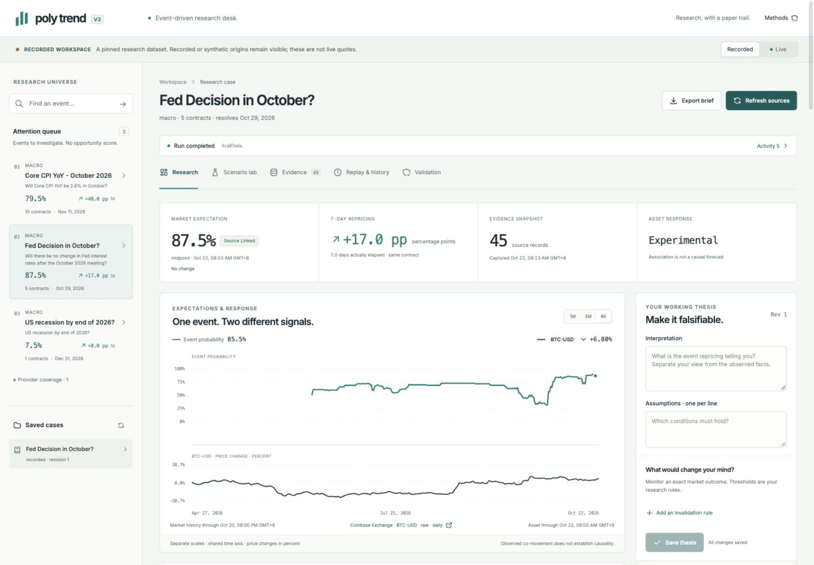

# Poly Trend V3

**Event Expectations & Asset Response Lab**

We investigate when prediction-market expectations add information to investment research,
and expose the evidence when they do not.

V3 connects exact event contracts to probability structure, public cross-asset histories,
challengeable investment theses and reproducible calculations. It is a research application
and hypothetical simulation environment. It contains no wallet, signing or order-placement code.



## Run locally

Requires Node 22, Python 3.12+, npm and [uv](https://docs.astral.sh/uv/).

```sh
npm ci
uv sync --project services/research --extra dev --frozen
uv run --project services/research polytrend-research
# In a second terminal:
npm run dev
```

Open http://localhost:3000. The web app proxies `/api/v3` through its server to
`INTERNAL_API_URL` (default http://127.0.0.1:8000). The API exposes docs at
http://127.0.0.1:8000/docs. SQLite stores local work in `data/polytrend-v3.db`.
Copy `.env.example` for available settings; your shell/process manager must load server variables.
Next.js reads root/web `.env.local` through its normal environment handling.

No key is required for public event discovery, CLOB snapshots, Coinbase BTC candles or
Treasury context. Alpha Vantage ETF data and FRED vintages need optional keys. Provider blocks,
rate limits and absent keys remain visible gaps. CSV imports can supply attributable daily asset
history with explicit adjustment metadata; imports cannot certify their own historical availability.

For Docker, set `POSTGRES_PASSWORD` in `.env`, then `docker compose up --build -d`.
This uses PostgreSQL and the same run service. Optional `--profile worker` adds a recovery/refresh
worker; database leases prevent duplicate run execution. The API already schedules enabled cases.
Docker is a single-user research deployment; add authentication and access controls before shared hosting.

## Research workflow

1. Discover an exact event and inspect its deadline, outcome/token identities, rules and source.
2. Save a case with an event → mechanism → asset thesis and measurable invalidation conditions.
3. Refresh to capture immutable evidence. Inspect quote quality, missing history, verified logical
   relationships, descriptive asset response and competing explanations.
4. Declare scenario payoffs and costs separately from observed data. Break-even probabilities
   and joint-probability bounds are calculated on the server.
5. Replay pinned evidence without network/model calls, or apply a historical cutoff that excludes
   subsequently available observations. Export the full run, input hashes and source payloads.

The interface has explicit **Live research** and **Recorded investigations** modes. Recordings
never replace a failed live request. Attention rankings identify research questions, not trades.
Historical associations are descriptive until independently evaluated across events. A small or
poorly covered sample produces an insufficient-evidence result.

## What changed in V3

- Canonical event, observation, case, claim, run and simulation contracts; generated frontend types.
- Gamma full families; CLOB books/fees/history; Data API **v2** trade, holder, position, interest and
  resolution capture; opt-in market stream with REST recovery and bounded watches.
- One LangGraph application service for manual runs, refresh, cancellation, restart recovery and replay.
- Content-addressed evidence snapshots, immutable source records and relational SQLite/PostgreSQL storage.
- Logical consistency and distributions only for verified relationships; original quotes remain visible.
- Bidirectional 1/5/20-session response diagnostics, explicit feed/adjustment gaps and independent-event limits.
- Saved thesis revisions, rule evaluation, scenario sensitivity, Frechet bounds and paper close-mark evaluation.

The V2 seed answer, giant probability forecast, duplicated browser math, generic gold forecast,
legacy refresh engine and task-count benchmark claims are retired. `/api/v1/*` and `/v1/*` return 410.
The older checkout is not migrated automatically; V3 uses a separate database and branch.

## Verify and reproduce

```sh
npm run typecheck
npm run build
uv run --project services/research python -m pytest services/research/tests
uv run --project services/research python evals/v3/run.py
uv run --project services/research python scripts/export_contracts.py
npm run contracts:generate
# Optional public-network recapture (can take several minutes):
uv run --project services/research python scripts/capture_showcases.py
```

The benchmark contains labelled synthetic positive and negative controls to test the evaluator.
It is **not evidence of investment alpha**. Empirical evaluation reports event calibration, asset
prediction and simulation separately, and remains insufficient until enough independently grouped,
chronologically available observations and outcome labels exist.

## Review the work

- [API integration guide](docs/POLYMARKET_API.md): identities, units, pagination, coverage and failures.
- [Architecture](docs/ARCHITECTURE.md): execution, persistence, contracts and deployment.
- [Methodology](docs/METHODOLOGY.md): alignment, logical structure, uncertainty and leakage controls.
- [Dataset and provenance](docs/DATASET.md): recordings versus synthetic fixtures and known limits.
- [User guide](docs/USER_GUIDE.md): live, recorded, replay, scenario and historical operations.
- [Recorded investigations](showcase/README.md): source-backed findings and capture manifest.
- [Verification evidence](design-qa.md): test coverage, responsive screenshots and deployment limits.

Initial assets are SPY, QQQ, IEF, TLT and BTC-USD, with Treasury yields and optional vintage macro
context. Monetary-policy events are the first research cohort; inflation, growth, trade policy
and geopolitics carry explicit coverage labels. Broad empirical claims require prospective data
collection and evaluation; historical probability charts cannot recreate historical books or holders.
