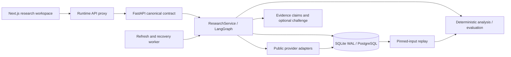

# Poly Trend V3 architecture

## Boundaries

Next.js renders the analyst workbench. Its same-origin `/api/v3` server proxy forwards to FastAPI
using the runtime `INTERNAL_API_URL`, including progress streaming. Keys stay on the research
server. Pydantic models are canonical: `scripts/export_contracts.py` exports OpenAPI and
`openapi-typescript` generates `@polytrend/contracts`. There is no second browser calculation engine.

FastAPI validates commands. `ResearchService` owns every run; its LangGraph executes capture →
calculate → challenge → publish. The optional model reviewer can challenge a thesis in prose but
cannot alter deterministic results. No key is required for calculation or replay. Source text is
untrusted evidence, never an instruction to the reviewer.

## Evidence and persistence

An `EventDefinition` contains contracts with distinct Gamma, condition and outcome-token IDs.
An `Observation` seals sanitized raw payloads with SHA-256, observation, receipt and availability
timestamps. A source payload is never overwritten. An `EvidenceBundle` pins event metadata,
observations, normalized market/asset series and missing-coverage issues; its serialized content
hash is its ID. Run exports include source payloads, hashes, seed and method version.

Relational tables index events by source mode, cases by update time, observations by source and
availability, runs by case/status, case revisions, progress, imports and execution leases.
SQLite uses WAL and bounded busy waiting. PostgreSQL uses psycopg's async pool; connection errors
never silently change the persistence driver. Source JSON remains in indexed relational rows.

Live and recorded events have separate storage keys. Imported assets include the original import
observation in each snapshot. Retrospective history has receipt-time availability, not an invented
earlier vintage. The historical cutoff applies to metrics, source-linked context claims and a separate presentation bundle for quotes/charts. Full pinned inputs remain available separately for audit; the UI never falls back to them for a historical display.

## Operations and recovery

- **Refresh** retrieves observations and stores a new evidence snapshot.
- **Replay** loads a pinned parent snapshot, method and seed, preserves its challenge and calls no providers.
- **Scenario** uses a saved snapshot with explicitly changed assumptions.
- **Historical** applies an explicit timezone-aware availability cutoff.

Jobs persist queued/running/stopped state and sequential progress events. SSE supports `Last-Event-ID`.
Cancellation retains captured evidence; resume continues using that evidence when available. On clean
shutdown tasks become interrupted. After abrupt failure, execution leases expire and recovery picks
up persisted jobs. The lease duration is run timeout plus 30 seconds. A completed result is not
mutable through the API; changing a thesis creates a new revision and run.

The API and optional worker share this service and leases. Watched-contract streaming is opt-in,
limited to 20 contracts, and reconciles REST state after reconnect. Stream gaps are observations.
Historical streams, books and holders exist only from actual capture onward.

## Deliberate limits

This is a single-user research environment. It does not include authentication, trading execution,
paid data redistribution or a claim that statistical significance implies implementable returns.
Provider budgets are bounded per process; a scaled deployment should coordinate provider quotas
across workers. Real empirical sample requirements are enforced separately from the synthetic
regression benchmark. Build/test commands and data limitations are in the main README.
